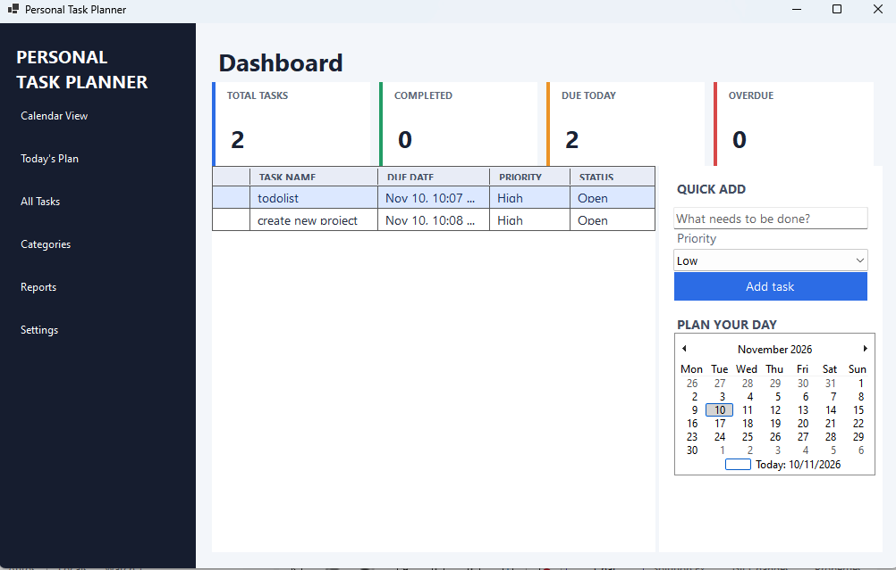
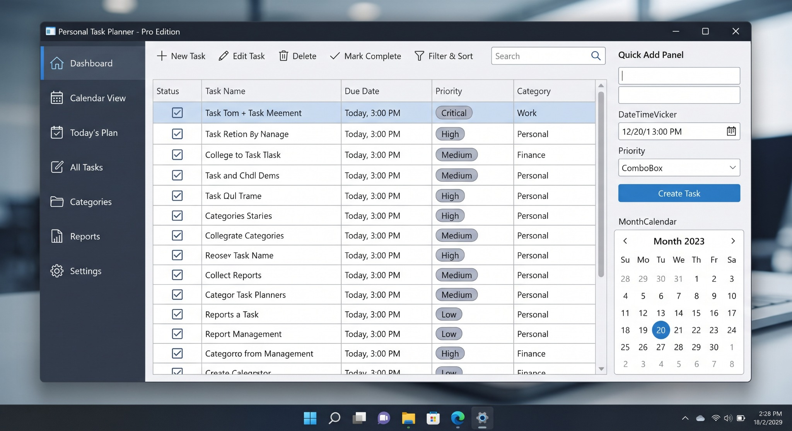

# PersonalTaskPlanner-WindowFormCSharp

A personal task planner built with C# and Windows Forms.

## Screenshots

### Current System

### Reference Dashboard

The target design the dashboard is modeled after.

## Documentation

- [Architecture](Documents/docs/architecture.md)
- [Excel storage](Documents/docs/excel-storage.md)
- [Roadmap](Documents/docs/roadmap.md)
